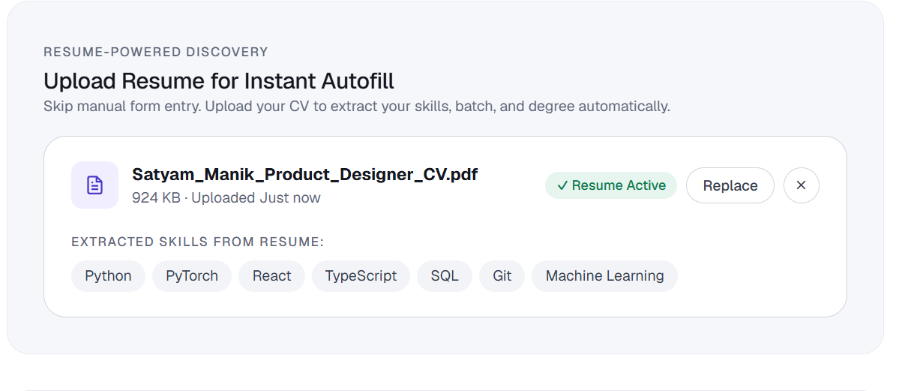
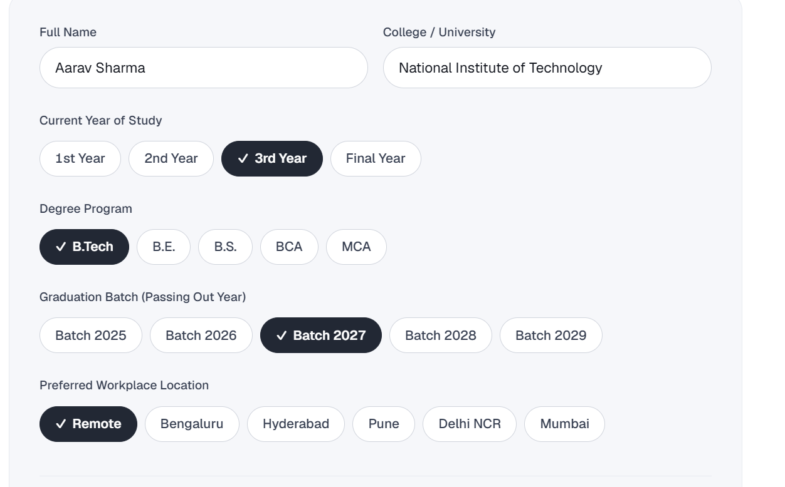

I want to connect with Supabase for the backend and create a new project. I need to connect to the new project, and you will completely help me. We will utilize Supabase MCP, okay? So, yeah, that's what we could do. 

The problem is that it extracted some core skills—such as tools—and assumed that this is an engineer’s resume. Because of that assumption, it made a wrong interpretation. A resume is very important, so the output should reflect that. If someone knows I have a different degree, it should write accordingly. Since the option isn’t available, it has all these issues, and everything changes. For instance, if there is a photo, it will also take the photo and my name will change completely. If I upload a resume, it will fetch the data. This is very important, okay. Look, Tiny Fish is already doing the backend skeleton, so we’ll also connect to Supabase properly and effectively. The accuracy we want for AJS should be very good. In other words, if it scanned my resume completely, it should understand the entire idea and know which type of opportunity would fit me best. These are the points; it’s quite simple but important. Because that’s basically everything—if that’s what he needs to do, it shouldn’t be too much. Whenever he does this, it is very important. Please help me fully with Supabase, as the backend needs to be operated to make it production‑ready and optimized. 