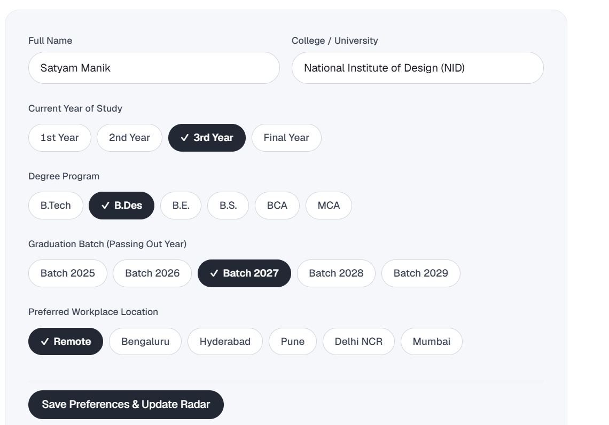

 The first point is that the profiling form is unnecessary if the resume has already been uploaded, so only essential information is required. The second point is that details such as college, year of study, and degree are not needed. Essential details include the name, the type of job being sought, and the preferred location. Information about graduation batch, degree, current year of study, and college should be omitted. If a resume has been uploaded, the form for opportunities is optional. Thus, the information to include here is crucial. Thank you. 

The Tinyfish backend is not functioning correctly. I have uploaded my resume, so the system should know what opportunities I am looking for and can suggest suitable options. Once the resume is uploaded, specific details in the profile section such as degree or experience are less important. Improving the backend so that it works properly with Tinyfish is essential. 

Accuracy reliable and consistent