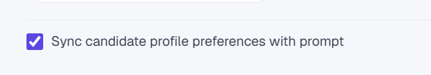
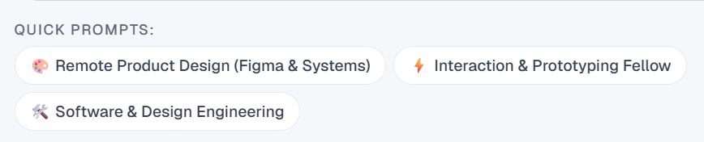
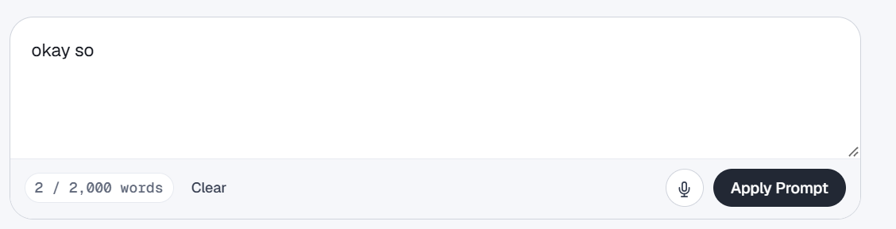

I just want insurance or assurance that when it comes to backend means their backend logic, I just want that they are using tiny fish and fire crawl. This is very important. I just want surety and all, because this is so essential. I don't want that issue it is using something else, okay? Because that's how we could maintain the reliability, consistency and accuracy. That is so important. So I just want that you have to check it and let me know, and it should, okay? And if it is not, please do it. It should must use when it comes to backend logic or the pattern tiny fish and fire crawl.

 bro, remove this. We don't need it at all, okay? 

 don't use emojis; use icons instead. Keep the icons consistent. align with design system 

 there is a problem with voice transcription: whenever I click and speak, it stops after only two words. I want it to last one to two minutes. While I’m speaking it should translate in real time, typing as I speak. It shouldn’t stop after two words; it should continue for at least one to two minutes, translating until I stop. Also, improve the animation. improve ux fix in animation right place ok and smoothness need ok not like blink ok 