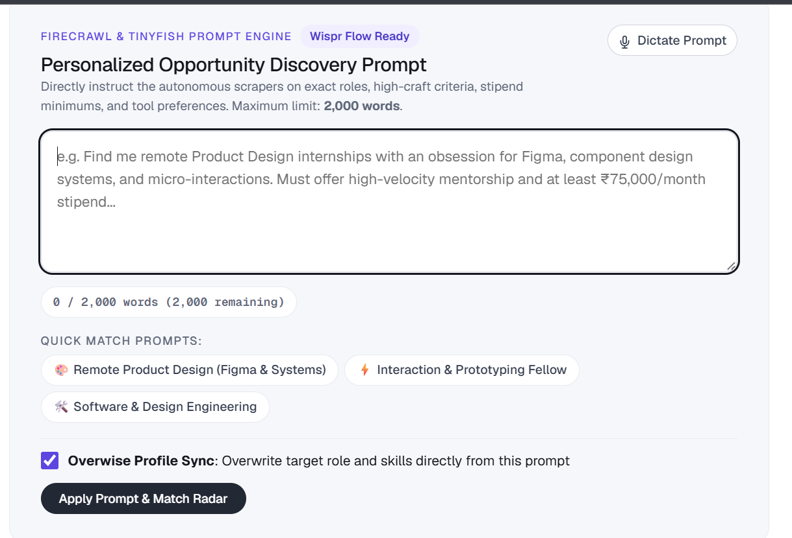
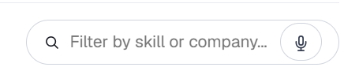
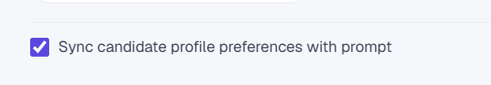
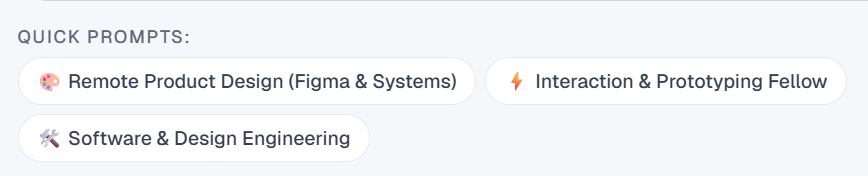
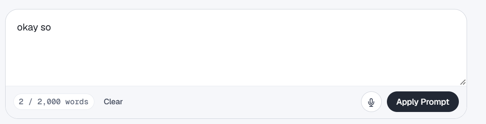

This mistake will appear in the card. You can see it on the right side. The icon there requires spacing. Below, the Apply At Official Portal button in the No button section also needs spacing. There's a purple badge, so check its spacing a bit. Adjust the spacing in the card. It needs to be corrected. 

And yes, in the sidebar there's a “Profile Fit” label. I’m not sure whether it’s needed or not. If I want to customize or edit my “Profile Fit,” that’s fine; it should be partial. The interface shows a pencil icon that allows me to edit it. In the sidebar, this feature may not be necessary, but if we use it as we do on the web it will stay the same, so each student’s profile remains personalized. This is helpful because users won’t have to search for what they need; the system will discover opportunities based on their uploaded data and present them. This setup works well. 

If we discuss WiRadar, you mentioned that WiCampusRadar exists, meaning we should use it compared to other platforms. You included a lot of extra information; we can present it in a simpler, concise way. Improve the presentation and user experience, keeping it short and clear. It currently takes up too much space, so present it more efficiently. Regarding the profile icon we used earlier, is that option necessary? It may not be needed; we could instead include the icon from Ravi Sharma’s profile. I’m not sure what the best approach is—perhaps you can try it. 

Okay, we are using a scanner here. First, this scan web—actually it’s a tiny fish? Remove the tiny fish or just keep the scan web. Two buttons are being used. Both are available; what can they do? The main point is its biggest feature: it can scrape opportunities from anywhere and present them well, something other platforms cannot do. That is the key feature. Do not highlight the tiny fish. I think we should move on to the next topic briefly. 

If we talk about copywriting, it refers to everything you have created—taglines, paragraphs, and other content. I believe it could be much improved. Make it simpler, use fewer words, and convey the message more effectively. Some parts feel unnecessarily long. This is very important, so refine the copy to be concise and easy to understand. 

Now look at this. How did you manage it? Check the user experience. You’ve done it completely, but it needs a bit of improvement. The user experience must be significantly better. How will you handle it? Everything feels a bit disorganized. Give it better pacing and improve the UI. The UI can be much better and needs fixing. 

And yes, this is a rolling visit. I’m not sure what to call it, but first, it needs to match the design system. It appears separate, completely different—almost like a default. It should align with the design system’s vibe and colors so that it looks consistent. 