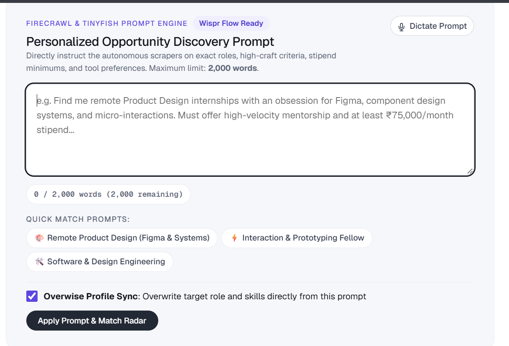
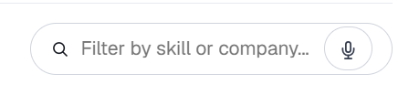

1. Header / Label Clean-up

• Issue: Labels like "fire crawl", "tiny fish", "prompt engine", and "whisper flow ready" are unnecessary.
• Action: Remove these terms completely. Do not highlight them or even keep them visible; they should be hidden entirely from the user interface.

2. Input Box & Voice Icon Optimization

• Issue: The text label "dictate dictate prompt" is redundant and not needed.
• Action: Remove the text entirely. A standalone microphone/voice icon is more than enough.
• Placement: Move this microphone icon inside the prompt input box itself, rather than keeping it outside.

3. Interactive Character/Word Counter

• Issue: The "2000 words limitation" text feels static and takes up unnecessary space outside the input field.
• Action: Move this counter inside the prompt input box. Make it fully interactive so that as the user types, it updates in real time to show the remaining word/character count.

4. Quick Match Prompt & Feature Flags

• Issue: The text explaining things like "emoji over-wise profile sync over-write target role skills directly from this prompt line check box" is too wordy, even though the underlying functionality is correct.
• Action: Remove that explanatory line completely. While this feature and its checkboxes will indeed apply to the Campus Radar system, the long text explanation is unnecessary and cluttering the UI. Clean up the emojis and simplify the overall presentation.

5. Voice Input Behavior (Long-lasting Mic Session)

• Issue: The microphone automatically cuts off and stops listening mid-sentence after only a few spoken words.
• Action: Modify the voice input logic to be long-lasting. The microphone must remain active and continuous until the user manually taps it to stop it. It should not auto-disconnect while the user is still speaking.iMPROVE Accuracy and reliable  

 iMprove consistent spacing ok 

note: And yes, brother, concerning the animation, transition, smooth experience, interection, and all other aspects—first, the voice input is also related to the prompt. Additionally, everything else and the entire scene need improvement. All of this concerns , as maintaining a smooth experience is essential. Please provide the design and improve experience interaction animation transition overall 